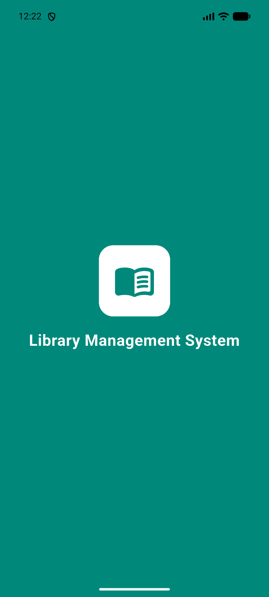
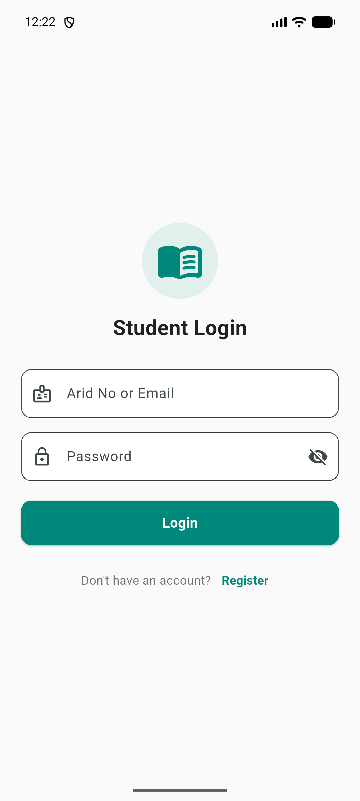
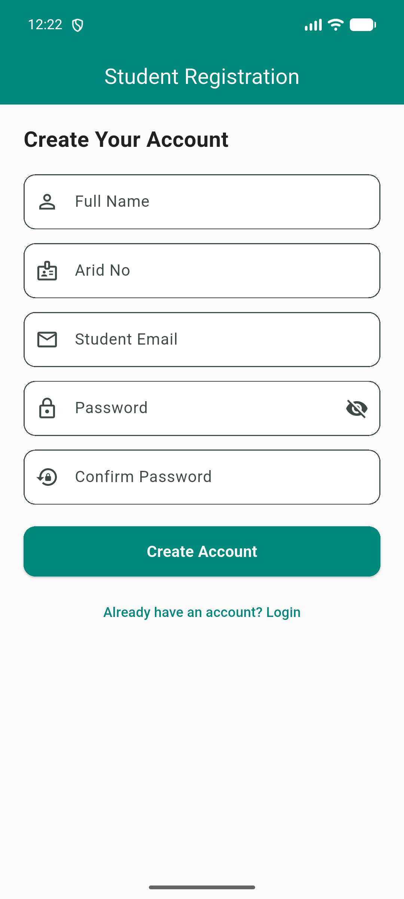
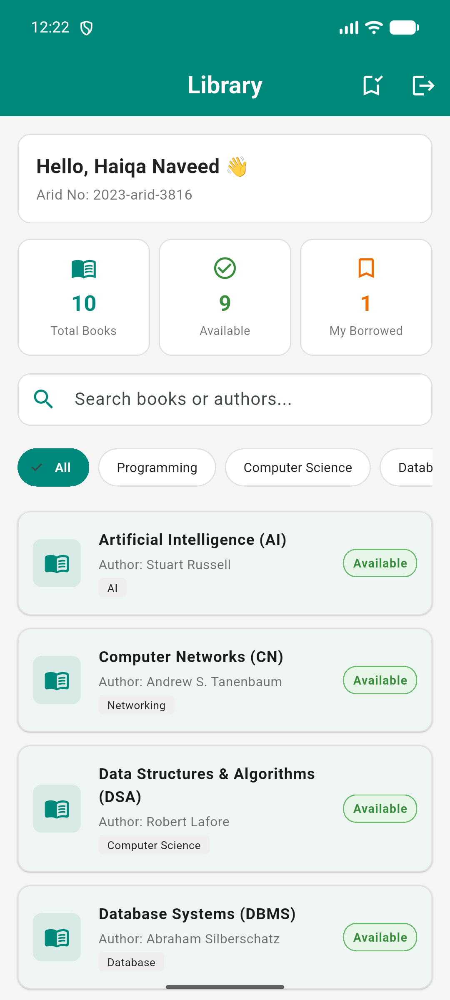
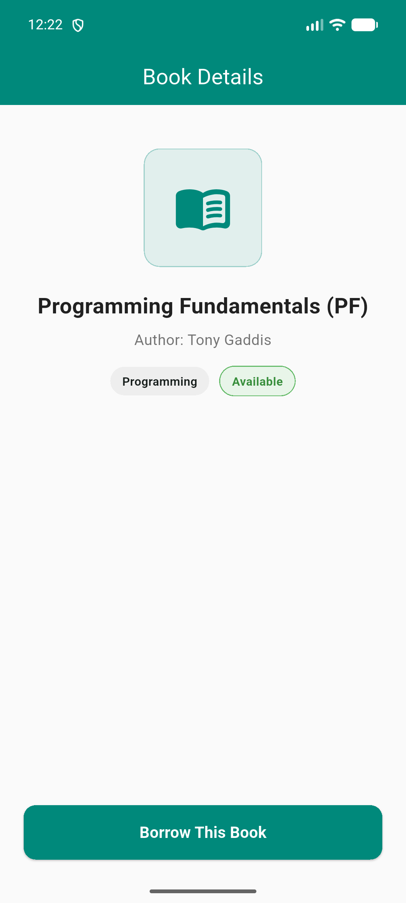
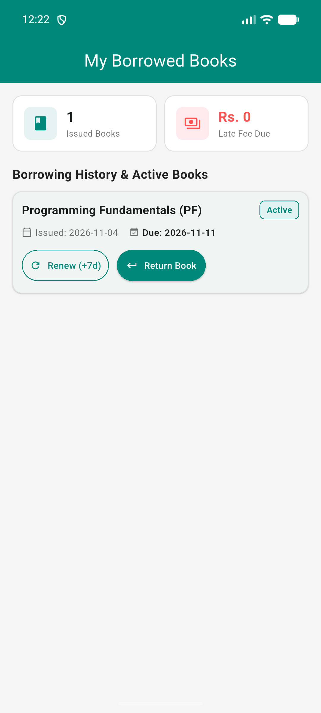

# Library Management System

A beginner-friendly Flutter application for university students to browse, borrow, and return library books using offline SQLite storage.

---

## 📸 Screenshots

| Splash Screen | Login | Registration |
|:---:|:---:|:---:|
|  |  |  |

| Dashboard | Book Details | Borrowed Books |
|:---:|:---:|:---:|
|  |  |  |

---

## 🛠️ Tech Stack

* **Flutter & Dart**: For building the mobile user interface.
* **SQLite (`sqflite`)**: For offline relational storage (Users, Books, Borrow Records).
* **Path (`path`)**: For managing database file paths on the device.

---

## ✨ Features

* **Student Auth**: Register and log in with Arid No (`e.g. 2023-arid-3816`) or Email.
* **Course Catalog**: Preloaded Computer Science books with real-time search & category filters.
* **Borrow & Return**: 7-day borrowing period (max 3 books) and one-time renewal (+7 days).
* **Late Fine**: Rs. 10/day overdue calculation with notice to pay the librarian upon return.
* **Clean Code**: Modular structure with reusable widgets in `lib/widgets/`.

---

## 🚀 How to Run

```bash
git clone https://github.com/M-S-A-K/Book_Shelf_LIbrary.git
cd Book_Shelf_LIbrary
flutter pub get
flutter run
```
