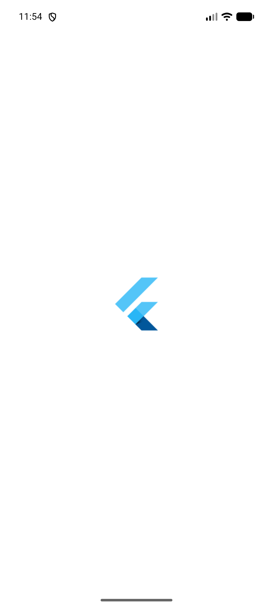
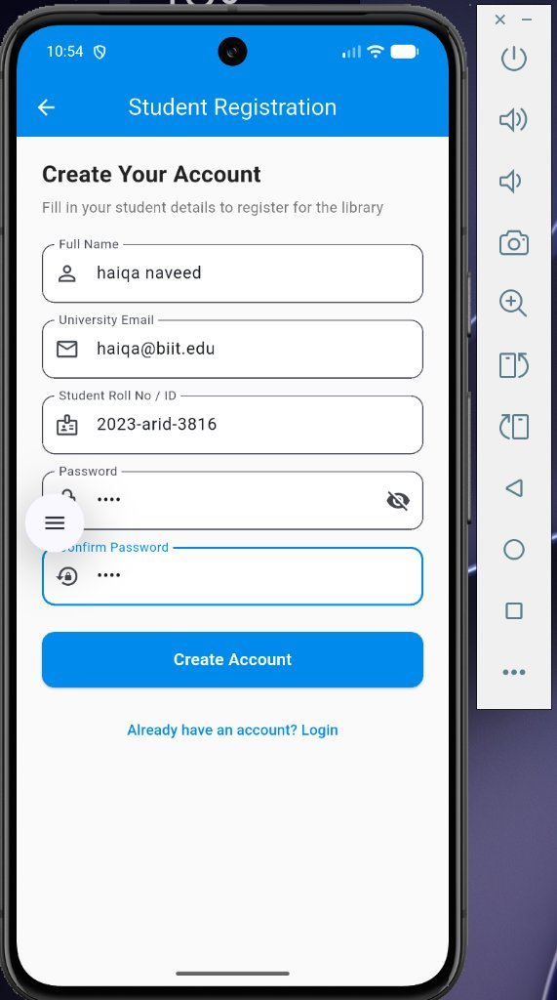
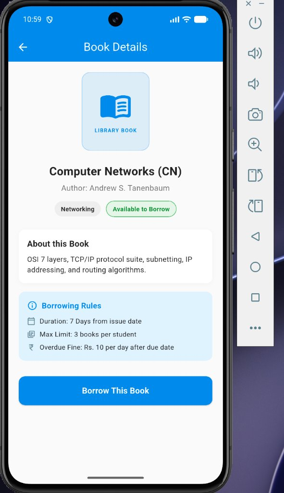
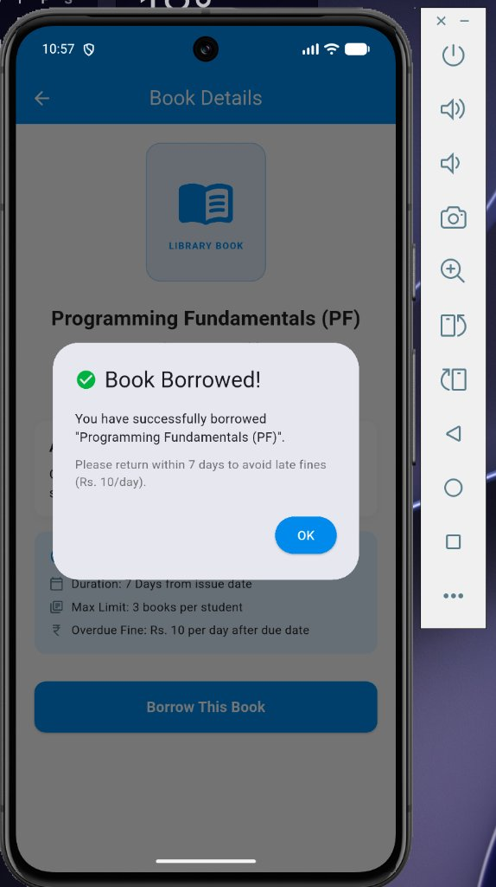
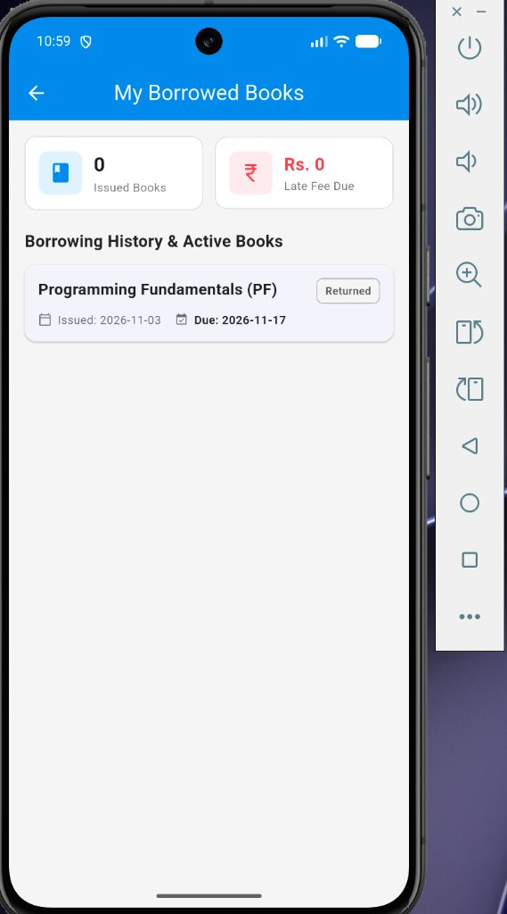

# Library Management System

A beginner-friendly Flutter mobile application for university students to browse, borrow, and return library books with offline SQLite database storage.

---

## 📸 App Screenshots

| Splash Screen | Student Login | Registration |
|:---:|:---:|:---:|
|  |  |  |

| Book Details | Borrow Confirmation | Borrowed Books & Return |
|:---:|:---:|:---:|
|  |  |  |

---

## 🛠️ Technologies Used

* **Flutter & Dart**: For building a fast, clean, and responsive student mobile UI.
* **SQLite (`sqflite`)**: For reliable local offline storage of users, books, and borrowing records with SQL tables.
* **Path (`path`)**: For easily resolving local device file paths to store the SQLite database.

---

## ✨ Features

* **Student Authentication**: Register with name, Arid No (`e.g. 2023-arid-3663`), and university email; log in with Arid No or Email.
* **Book Catalog**: Preloaded real-world Computer Science books (PF, DSA, OOP, DBMS, OS, CN, SE, AI, etc.).
* **Search & Filter**: Real-time keyword search and category filter chips.
* **Borrowing Rules**: 7-day borrowing duration with a maximum limit of 3 books per student.
* **Renewal System**: One-time renewal (+7 days) per borrowed book.
* **Overdue Fine**: Automatically calculates late fees (Rs. 10/day) with notice to pay the librarian upon return.
* **Modular Code**: Clean project structure with reusable widgets in `lib/widgets/`.

---

## 🚀 How to Clone and Run

### 1. Clone the repository
```bash
git clone https://github.com/M-S-A-K/Book_Shelf_LIbrary.git
cd Book_Shelf_LIbrary
```

### 2. Install dependencies
```bash
flutter pub get
```

### 3. Run the app (on Android emulator or physical device)
```bash
flutter run
```
